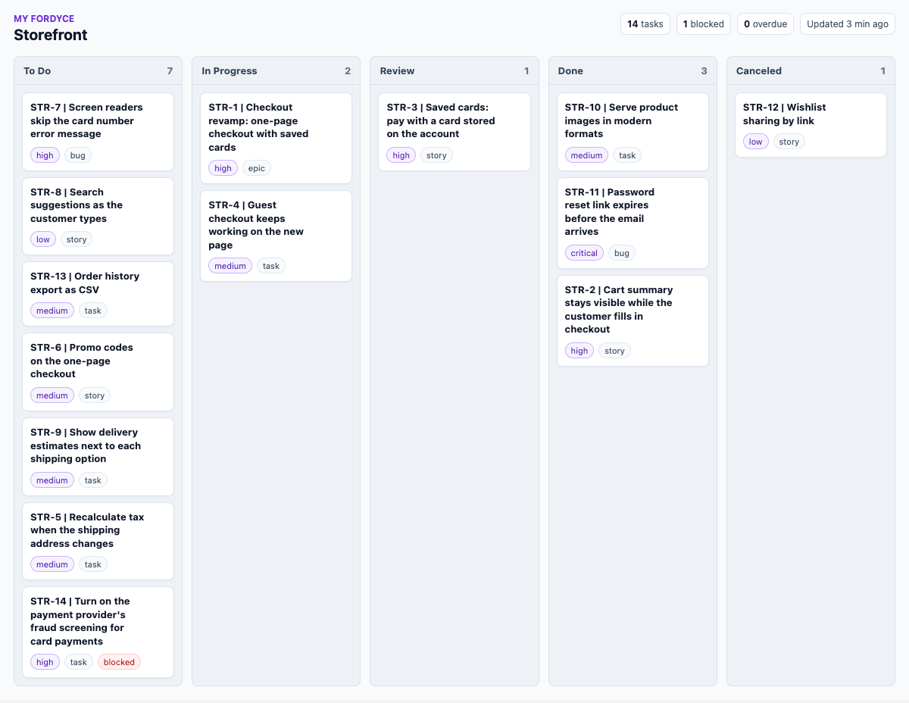

# My Fordyce for Claude

**One backlog for all your coding agents.** When you run several agents at once, each one asks My Fordyce for work and gets one ticket nobody else holds. If a session goes quiet, its ticket goes back for the next agent. Finished work waits at Review for a person.



This plugin connects Claude to My Fordyce and teaches Claude how to use it well.

## Install

**From Claude Code**

```
/plugin marketplace add Fordyce-CG/myfordyce-plugin
/plugin install my-fordyce@fordyce-cg
```

**Connector only, without the skills**

```
claude mcp add --transport http my-fordyce https://myfordyce.fordycecg.com/mcp-app
```

**In Claude (web, desktop, mobile):** add the My Fordyce connector from Claude's connector settings with the server URL `https://myfordyce.fordycecg.com/mcp-app`.

The first time Claude uses My Fordyce, it opens the My Fordyce sign-in page. Sign in, or create an account and start the 14-day trial, then approve access. You land back in Claude, connected. No API key is stored in this plugin.

Want to look first? The [demo board](https://myfordyce.fordycecg.com/demo) runs in your browser with no account.

## Try it

Once connected, ask Claude:

- "Open the board for my project."
- "Plan the CSV export feature as tickets an agent can finish."
- "Take the next ticket and work it."
- "What is waiting for me at Review?"

## What the skills add

| Skill | Use it when |
| --- | --- |
| `run-agent-work` | A coding agent is taking tickets: getting the next one, keeping the claim, declaring files, recording a pull request, and writing a hand-off summary |
| `plan-agent-work` | You ask Claude to add, split or organise tickets so agents can finish them |
| `review-agent-work` | You want to see what every agent is doing, and accept or send back finished work |

The same board works from Claude, Claude Code, ChatGPT and Codex, so a team can mix tools and machines and still work from one plan. Setup guides for each are at [fordycecg.com/guides](https://fordycecg.com/guides).

New to running several agents at once? Our field manual, [Through the Woods](https://fordycecg.com/field-manual), covers what we learned running them on one codebase.

## What this plugin runs and sends

- **One remote MCP server:** `https://myfordyce.fordycecg.com/mcp-app`, declared in `.mcp.json`. Claude sends tool calls to it over HTTPS, signed in with your My Fordyce account.
- **What it sends:** the tool calls Claude makes on your behalf, such as reading a ticket, creating a ticket or recording evidence. It does not read your files, your conversations or your environment.
- **Nothing else:** no hooks, no scripts, no local servers, no package installs. The skills are plain instructions for Claude.

## Privacy

My Fordyce is run by Fordyce CG. The data the connector stores (projects, tickets, their history and the evidence agents record) is handled under the Fordyce CG privacy policy: [fordycecg.com/privacy](https://fordycecg.com/privacy). It describes what is collected, how it is used and stored, who it is shared with, how long it is kept, and how to contact us.

## Support

Email [support@fordycecg.com](mailto:support@fordycecg.com). Setup guides are at [fordycecg.com/products/myfordyce/mcp](https://fordycecg.com/products/myfordyce/mcp).

## License

MIT. See [LICENSE](LICENSE).
